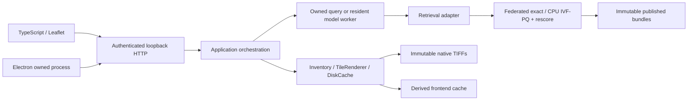

# Architecture and ownership

Read [AGENTS.md](../AGENTS.md) for engineering invariants and
[PROJECT_STATE.md](PROJECT_STATE.md) for dated local observations. This guide
describes boundaries; it is not permission to start a pipeline operation.

## Boundaries

| Layer | Main entry points | Responsibility |
| --- | --- | --- |
| Acquisition | `download_nys_naip.py`, `download_gapfill.py` | Provenance, immutable sources, guarded publication |
| Encoding | `embed_georsclip.py`, `embed_gapfill.py` | Lazy windows, GPU encoding, recipe-bound atomic bundles |
| Control | `embedding_control.py`, `gapfill_control.py` | Pause acknowledgement, collection and shared GPU ownership |
| Retrieval | `search_text.py`, `search_index.py`, `federated.py` | Exact baseline, optional candidates, original-vector scores, qualified exclusions |
| Desktop | [main.cjs](../frontend/desktop/main.cjs) | Window and owned Python service lifecycle; renderer isolation |
| HTTP | [http_server.py](../frontend/service/http_server.py) | Authentication, origin/Host validation, bounded handlers, routes/errors |
| Application | [server.py](../frontend/service/server.py) | Search/model/overview orchestration, persisted state, owned shutdown |
| Worker | [search_worker.py](../frontend/service/search_worker.py) | One-shot or resident request processing, atomic results/status |
| Retrieval adapter | [retrieval.py](../frontend/service/retrieval.py) | Model compatibility, locks, cached query vectors, frontend result shapes |
| Display | [imagery.py](../frontend/service/imagery.py), [overview.py](../frontend/service/overview.py), [storage.py](../frontend/service/storage.py) | Mask-aware display, cancellation, bounded cache and overview preparation |
| UI | [main.ts](../frontend/ui/main.ts), [types.ts](../frontend/ui/types.ts), [api.ts](../frontend/ui/api.ts), [local-tiles.ts](../frontend/ui/local-tiles.ts) | Application state/rendering, transport types/auth, bounded Leaflet scheduling |

Backend code names in the table are under `src/geospatial_search/`.

## Request and process lifecycle

The desktop starts one loopback service with a per-launch session token. The
HTTP layer validates Host, Origin, and token before API routing. Static assets
come from the bounded local build directory. The service's frontend-local lock
protects cache ownership. It uses bounded handlers and raster work queues.

Imagery browsing reads native TIFF windows or derived display overviews without
loading a model. Display reprojection never alters source grids or masks.
Decoded tiles remain available during replacement zooms; obsolete unfinished
requests cancel without discarding already-loaded imagery prematurely.

A query starts an owned worker or reuses an explicitly preloaded resident
worker. The retrieval adapter reserves collection and job-wide GPU locks before
model loading, validates the pinned contract, encodes or reuses a compatible
query vector, searches compatible dataset snapshots, resolves original metadata,
and verifies matched source hashes. Search progress is passed through an explicit
callback; frontend requests do not replace backend module-global progress tools.
Results and worker status publish atomically. One-shot completion is acknowledged
after process teardown so the next query cannot race lock release.

Resident workers retain their model and locks between queries. Closing the app
stops its owned processes. Borrowed services and embedding workers are never
terminated by browser checks or automatically paused by the frontend.

## Compatibility and storage

The four core source files (`embed_georsclip.py`, `tiling.py`, `model.py`,
`bundles.py`) are hashed into recipes along with model, preprocessing, source,
grid, and dependency fingerprints. Supplements add adapter hashes. A different
recipe uses a distinct output collection; preserved bundles are never rewritten
to fit a refactor. See [contracts](CONTRACTS.md) for schema owners.

The primary job owns imagery, provenance, published vectors, indexes, pipeline
temporary files, and CLI results under the shared 300 GB guard. Frontend display
artifacts have separate DiskCache accounting. Small frontend state/logs are
outside imagery-cache accounting. These are software guards, not OS quotas.

## Isolated development boundary

[create_synthetic_job.py](../scripts/create_synthetic_job.py) generates a marked
synthetic job and seeded vectors under ignored temporary folders. The separate
[dev_server.py](../frontend/service/dev_server.py) reuses HTTP/display components
but supplies fixture query/model responses. Production startup does not select
this service or accept its synthetic contract. See [DEVELOPMENT.md](DEVELOPMENT.md)
for fresh-clone commands and validation tiers.
